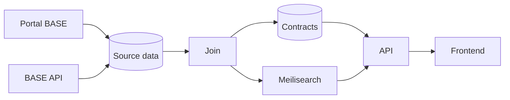

# Architecture

How contract data gets from its sources to the site: where it comes from and how it moves through the pipeline. See [Concepts](CONCEPTS.md) for what the terms mean.

## Data sources

The data comes from two sources, the [BASE API](https://www.base.gov.pt/APIBase2) and the [Portal BASE website](https://www.base.gov.pt/). Both have contracts, entities and modifications, but each has fields the other doesn't and they differ a lot in how fast they can be read, so we need both.

The BASE API requires an access token. A full download takes about 8 minutes, so we can use it to refresh the whole database quickly. It can also return only the contracts whose last update was in the last few days.

To get a token, you can open a ticket on the [IMPIC helpdesk](https://www.impic.pt/support/open.php) with the topic "Contratos Publicos / Pedido de acesso a API Portal Base". IMPIC sends the token once they approve the request.

The Portal BASE website is public, and we scrape the API that feeds the frontend. Unlike the BASE API, which only goes back to 2012, it has every contract. It's also more up to date, and it's the only source of documents, invitees and entity ids. However, its rate limit is very restrictive, allowing only one request every 2 seconds, so a full scrape of about 2.5M contracts takes about 59 days.

[dados.gov](https://dados.gov.pt/) also has this data, but it's the same data as the BASE API and is only published weekly, so we don't use it.

## Pipeline



### Fetch

The Portal BASE is scraped as new contracts appear, respecting the rate limit. The scraper goes through each page of contracts, checks whether any haven't been scraped yet, and downloads each of those.

The BASE API is checked every hour. We download the contracts whose last update was in the last 2 days, adding the new ones and updating the ones we already have. To catch any changes that were missed, every contract is downloaded again every week. This is also run manually with the CLI when needed (e.g., when first setting up the database).

The BASE API can return several rows for the same contract id. How we handle this is TBD.

If a contract that is saved in the database no longer appears in a full BASE API download, we need to handle the deletion. This is still TBD, but one option is to fetch it from the Portal BASE, and mark it as deleted if the portal returns an empty record as well.

The data from each source is saved as received in the `raw_contracts` table, with one row per contract and source. The join step processes it later.

```sql
CREATE TYPE contract_source AS ENUM ('base_portal', 'base_api');

CREATE TABLE raw_contracts (
    source contract_source NOT NULL,
    contract_id BIGINT NOT NULL,
    data JSONB NOT NULL,
    fetched_at TIMESTAMPTZ NOT NULL DEFAULT now(),
    PRIMARY KEY (source, contract_id)
);
```

This lets us run the join step again whenever we want to handle existing fields differently.

When a contract in the BASE API changes (the fetched data is different from the saved data), the contract is fetched again from the Portal BASE, so both sources stay up to date. Most of these changes happen when a contract is closed, which adds a close date, a final price and an end-of-contract type. The portal usually changes at the same time.

The contracts to fetch again are kept in a `portal_refetch_queue` table. The scraper then fetches every contract in the queue, and removes each one once it's saved.

```sql
CREATE TABLE portal_refetch_queue (
    contract_id BIGINT PRIMARY KEY,
    version BIGINT NOT NULL DEFAULT 0
);

CREATE TRIGGER base_api_contracts_updated AFTER UPDATE ON raw_contracts
REFERENCING NEW TABLE AS changed FOR EACH STATEMENT EXECUTE FUNCTION enqueue_portal_refetch();
```

A contract can change again while it's being fetched, so each queue entry also has a version, which goes up every time the contract is queued again. The scraper only removes a contract from the queue if its version didn't change during the fetch. Otherwise, it's fetched again.

### Join

The join merges the data from both sources into one coherent contract, with every field parsed and in a consistent format. The result is saved to the `contracts` table in Postgres and to Meilisearch, which is what the site uses.

The contracts to join are kept in a `join_queue` table, which works like the [portal refetch queue](#fetch). A trigger on `raw_contracts` adds a contract to it every time one of its rows is added or changes, and notifies the joiner with `pg_notify`. The joiner then goes through the queue: for each contract, it reads its rows from `raw_contracts`, joins them, saves the result to `contracts` and Meilisearch, and removes the contract from the queue.

```sql
CREATE TABLE join_queue (
    contract_id BIGINT PRIMARY KEY,
    version BIGINT NOT NULL DEFAULT 0
);

CREATE TRIGGER raw_contracts_inserted AFTER INSERT ON raw_contracts
REFERENCING NEW TABLE AS changed FOR EACH STATEMENT EXECUTE FUNCTION enqueue_join();

CREATE TRIGGER raw_contracts_updated AFTER UPDATE ON raw_contracts
REFERENCING NEW TABLE AS changed FOR EACH STATEMENT EXECUTE FUNCTION enqueue_join();
```

If a contract changes again while it's being joined, its version goes up, so it stays in the queue and is joined again on the next run, just like in the refetch queue.

### Serving

The API reads contracts from the `contracts` table, searches them through Meilisearch, and returns them to the frontend.
