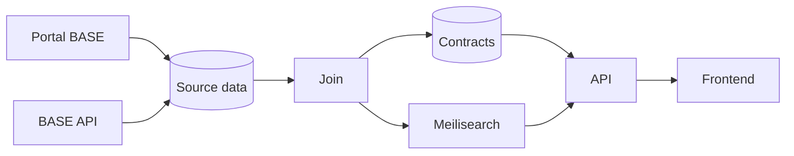

# Architecture

How contract data gets from its sources to the site: where it comes from and how it moves through the pipeline. See [Concepts](CONCEPTS.md) for what the terms mean.

## Data sources

The data comes from two sources, the [BASE API](https://www.base.gov.pt/APIBase2) and the [Portal BASE website](https://www.base.gov.pt/). Both have contracts, entities and modifications, but each has fields the other doesn't, so we need both.

The BASE API requires an access token. TODO EXPLAIN HOW TO OBTAIN THE TOKEN. A full download takes about 8 minutes, and it can also return only the contracts published or changed in the last days.

The Portal BASE website is public, and we scrape the API that feeds the frontend. Unlike the BASE API, which only goes back to 2012, it has every contract, and it's also more up to date. However, its rate limit is very restrictive, allowing only one request every 2 seconds, so a full scrape of about 2.5M contracts takes about 59 days.

## Pipeline



### Fetch

The Portal BASE is scraped as new contracts appear, respecting the rate limit. The scraper goes through each page of contracts, checks whether any haven't been scraped yet, and downloads each of those.

The BASE API is checked every hour. We download the contracts published or changed in the last 2 days, adding the new ones and updating the ones we already have. To catch any changes that were missed, every week, every contract is downloaded again and updated. This is also run manually when needed (e.g., when first setting up the database).

The BASE API can return several rows for the same contract id. How we handle this is TBD.

When a contract in the BASE API changes (the fetched data is different from the saved data), the contract is fetched again from the Portal BASE, so both sources stay up to date.

If a contract that is saved in the database no longer appears in a full BASE API download, we need to handle the deletion. This is still TDB, but one option is to fetch it from the Portal BASE, and mark it as deleted if the portal returns an empty record as well.

The data from each source is saved as received in a table, `raw_contracts`, with one row per contract and source. The join step processes it later.

```sql
CREATE TYPE contract_source AS ENUM ('base_portal', 'base_api');

CREATE TABLE raw_contracts (
    source contract_source NOT NULL,
    contract_id BIGINT NOT NULL,
    data JSONB NOT NULL,
    fetched_at TIMESTAMPTZ NOT NULL DEFAULT now(),
    PRIMARY KEY (source, contract_id)
);
```

This lets us run the join step again whenever we want to handle existing fields differently.

### Join

The join merges the data from both sources into one coherent contract, with every field parsed and in a consistent format. The result is saved to the `contracts` table in Postgres and to Meilisearch, which is what the site uses.

### Serving

The API reads contracts from Postgres, searches them through Meilisearch, and returns them to the frontend.
