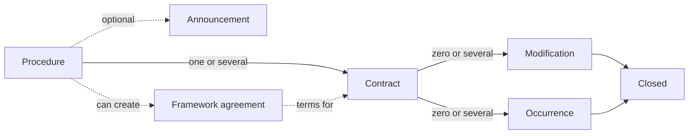

# Concepts

The lifecycle of a public contract in Portugal, from choosing a supplier to the end of the contract.

A public entity that wants to buy something starts a **procedure**, the legal process used to choose a supplier. The procedure can have an **announcement**, its public notice, but many don't. Entities then compete for the contract, either on their own or because they were invited.

A procedure can lead to one or several **contracts**, or end with no contract at all. It can also create a **framework agreement**, which sets the terms in advance for contracts made later.

A contract is the agreement between the contracting entities and the suppliers, and it's published on Portal BASE. While it runs, it can get **modifications**, which are changes after signing, usually to its price or deadline. The entity can also report **occurrences**, which are notable events such as a breach or a penalty.

When the contract is **closed**, the entity reports when it ended, how it ended and its final price.
